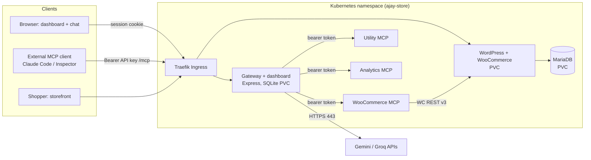

# Project AJAY — Team MCP Gateway on Kubernetes

Project AJAY is a WooCommerce store, hosted on Kubernetes, with a **team MCP gateway** in front of it. A team of admins and members uses a single MCP endpoint and their own API keys to reach the tools of several upstream MCP servers, including a self-written WooCommerce MCP server. A dashboard handles servers, members, keys, audit and an AI chat agent that calls the same tools as the logged-in user.

Built for the Urumi AI FDE internship, Round 1 ("MCP Gateway on Kubernetes").

- Design: [docs/system-design.md](docs/system-design.md)
- Threat model: [docs/threat-model.md](docs/threat-model.md)
- Two-user demo runbook: [docs/demo-runbook.md](docs/demo-runbook.md)
- Readiness audit and status: [docs/vps-readiness-audit.md](docs/vps-readiness-audit.md)

> **Status, 2026-10-23.**
> - Everything below runs on a local **Kind** cluster through Helm and has been verified there, except where it is marked otherwise.
> - VPS (k3s) deployment uses the same chart with [`values-prod.yaml`](deploy/helm/urumi-platform/values-prod.yaml). It **has not been deployed yet**; see [VPS deployment](#vps-deployment-k3s).

## Contents
- [Capabilities](#capabilities)
- [Architecture](#architecture)
- [Technology stack](#technology-stack)
- [Repository structure](#repository-structure)
- [Prerequisites](#prerequisites)
- [Local setup (Kind)](#local-setup-kind)
- [VPS deployment (k3s)](#vps-deployment-k3s)
- [Configuration: environment variables and Secrets](#configuration-environment-variables-and-secrets)
- [Users, onboarding and API keys](#users-onboarding-and-api-keys)
- [Connecting an external MCP client](#connecting-an-external-mcp-client)
- [MCP servers and tools](#mcp-servers-and-tools)
- [RBAC and audit logging](#rbac-and-audit-logging)
- [AI chat agent](#ai-chat-agent)
- [Storefront and COD orders](#storefront-and-cod-orders)
- [Tests](#tests)
- [Security summary](#security-summary)
- [Demo walkthrough](#demo-walkthrough)
- [Troubleshooting](#troubleshooting)
- [Known limitations](#known-limitations)
- [Stand-out items attempted](#stand-out-items-attempted)

## Capabilities
- **One MCP endpoint:** `POST /mcp` (Streamable HTTP, stateless, JSON responses). It aggregates the tools of every enabled upstream server as `<server-slug>__<tool>`.
- **Three upstream MCP servers** in the cluster, with 16 tools in total:
  - WooCommerce (self-written, 6 tools)
  - Utility (5 tools)
  - Sales Analytics (5 tools)
- **Failure isolation:** per-call timeouts, and a dead or slow upstream only removes its own tools. Upstream status is Connected, Unreachable or Disabled.
- **Teams:**
  - `admin` and `member` roles
  - one-time invite links
  - per-user API keys (shown once, stored as SHA-256 hashes, revocable)
  - per-server admin-only tools
- **Audit log** of every tool call: user, server, tool, time, duration, outcome and source (`mcp`, `rest` or `chat`). It is visible in the dashboard.
- **AI chat** in the dashboard. It uses Gemini first and falls back to Groq. It calls tools through the same gateway path as the logged-in user, and asks for approval before writes.
- **Kubernetes:** a single Helm chart for everything, with:
  - persistent volumes for MariaDB, WordPress and the gateway SQLite DB
  - Traefik Ingress
  - probes, requests and limits on every chart workload
  - Secrets for all credentials
  - default-deny NetworkPolicies

## Architecture



See [docs/system-design.md](docs/system-design.md) for the request flow, data model and trade-offs.

## Technology stack
| Layer | Technology |
|---|---|
| Gateway | Node.js 24, TypeScript, Express 5, `@modelcontextprotocol/sdk`, `node:sqlite` (WAL), zod, pino |
| Dashboard | Vite, React 19, Tailwind CSS 4, React Router 7, TanStack Query, react-markdown (no raw HTML) |
| MCP servers | TypeScript, MCP SDK Streamable HTTP. WooCommerce server uses the WooCommerce REST API v3 |
| Store | WordPress `php8.3-apache` + WooCommerce, MariaDB 11.4 |
| LLM | Google Gemini (native API), Groq (OpenAI-compatible), free tiers |
| Platform | Kind (local), k3s (VPS target), Helm, Traefik, cert-manager (VPS) |

## Repository structure
```
apps/
  gateway/           Express gateway: /mcp, /api, auth, audit, chat agent, admin CLI (Dockerfile builds gateway + dashboard)
    src/mcp/         upstream-manager.ts, gateway-tools.ts (single dispatch path), tool-names.ts
    src/routes/      mcp-endpoint.ts, mcp.ts (REST), auth.ts, account.ts, admin.ts, chat.ts, health.ts
    src/chat/        agent.ts (tool loop), providers/ (gemini.ts, groq.ts)
    src/db/          SQLite schema and queries (users, keys, sessions, servers, audit, conversations)
    src/scripts/     admin.ts operator CLI
  dashboard/         React SPA (servers, team, keys, audit, chat)
  mcp-woocommerce/   Self-written WooCommerce MCP server (6 tools)
  mcp-business/      One image, two servers: utility and analytics (5 tools each)
deploy/
  helm/urumi-platform/  The chart: values.yaml, values-local.yaml, values-prod.yaml, templates/
  traefik/values-kind.yaml  Traefik values for Kind
  k3s/               Traefik HelmChartConfig (HTTPS redirect) and cert-manager ClusterIssuer for the VPS
  k8s/mcp-woocommerce/  Legacy raw manifests, superseded by the Helm chart (kept for reference)
docs/                Design, threat model, demo runbook, readiness audit
```

## Prerequisites
- Docker Desktop (or another Docker engine). The Kind node needs at least 4 GB; see [Troubleshooting](#troubleshooting).
- `kind`, `kubectl`, `helm` (v3.13+ or v4)
- Node.js 24 and npm (for builds and tests outside Docker)
- Optional: a Gemini and/or Groq API key for the chat agent

## Local setup (Kind)

Commands are PowerShell-compatible and run from the repository root. Values in `<…>` are yours to choose. Never commit them.

**1. Cluster and namespace.**
```powershell
kind create cluster --name ajay
kubectl create namespace ajay-store
```

**2. Build the images and load them into Kind** (`pullPolicy: Never` locally):
```powershell
docker build -f apps/gateway/Dockerfile -t ajay-gateway:dev .
docker build -f apps/mcp-woocommerce/Dockerfile -t ajay-mcp-woocommerce:0.2.0 .
docker build -f apps/mcp-business/Dockerfile -t ajay-mcp-business:dev .
kind load docker-image ajay-gateway:dev ajay-mcp-woocommerce:0.2.0 ajay-mcp-business:dev --name ajay
```

**3. Create the operator-managed Secrets.** Only the names and keys are shown here; put the values in a local, uncommitted env file.

| Secret | Keys | Used by |
|---|---|---|
| `ajay-mariadb-auth` | `root-password`, `user-password` | MariaDB, WordPress |
| `ajay-mcp-auth` | `token` | WooCommerce MCP server (inbound bearer), gateway (outbound) |
| `ajay-woocommerce-api` | `consumer-key`, `consumer-secret` | WooCommerce MCP server → WC REST API (create after step 6) |
| `ajay-gateway` | `GEMINI_API_KEY`, `GROQ_API_KEY`, `BOOTSTRAP_ADMIN_PASSWORD` (all optional) | Gateway |
| `<release>-mcp-business-auth` | `utility-token`, `analytics-token` | **Generated by the chart** and kept across upgrades |

```powershell
kubectl create secret generic ajay-gateway -n ajay-store --from-env-file=<path-to-local-env-file>
```

**4. Install Traefik** (Kind publishes no ports 80/443, so Traefik is a ClusterIP service reached through a port-forward):
```powershell
helm install traefik oci://ghcr.io/traefik/helm/traefik --version 42.1.3 -n traefik --create-namespace --skip-crds -f deploy/traefik/values-kind.yaml
```

**5. Install the platform:**
```powershell
helm upgrade --install ajay deploy/helm/urumi-platform -n ajay-store -f deploy/helm/urumi-platform/values-local.yaml --wait
kubectl port-forward -n traefik svc/traefik 8080:80
```

**Local domains.** `*.localtest.me` is public DNS that resolves to `127.0.0.1`, so no hosts-file edits are needed.

| URL | What |
|---|---|
| http://ajay.localtest.me:8080 | Dashboard, `/api`, `/invite/<token>` |
| http://ajay.localtest.me:8080/mcp | MCP endpoint |
| http://store.localtest.me:8080 | Storefront and `/wp-admin` |

`wordpress.siteUrl` sets `WP_HOME`/`WP_SITEURL` through `WORDPRESS_CONFIG_EXTRA`, so it must match the browser URL, including the port.

**6. One-time store setup.** This is manual; it was not automated for the local cluster.
1. Run the WordPress installer at the store URL.
2. Install and activate WooCommerce.
3. Set the currency (the demo store uses INR) and enable **Cash on delivery**.
4. Create a REST API key (WooCommerce → Settings → Advanced → REST API, Read/Write) and store it in the `ajay-woocommerce-api` Secret.
5. Restart the WooCommerce MCP Deployment once so it picks up the key.

**7. First admin.** On an empty database the gateway creates `gateway.bootstrapAdminEmail` (local: `admin@ajay.local`) with the password from `BOOTSTRAP_ADMIN_PASSWORD`. The three bundled MCP servers are registered automatically on every start (`gateway.bundledServers` in `values.yaml`).

**Upgrade and rollback:**
```powershell
helm upgrade ajay deploy/helm/urumi-platform -n ajay-store -f deploy/helm/urumi-platform/values-local.yaml --wait
helm history ajay -n ajay-store
helm rollback ajay <revision> -n ajay-store --wait
```

> Roll back only to revisions that already contain the WooCommerce MCP templates. An older revision would delete objects that later revisions adopted.

## VPS deployment (k3s)

> **Planned, not yet deployed.** The chart and [`values-prod.yaml`](deploy/helm/urumi-platform/values-prod.yaml) are prepared and lint and render cleanly. The steps below are the intended procedure; see [docs/vps-readiness-audit.md §7](docs/vps-readiness-audit.md#7-vps-readiness) for open items.

| Concern | Local (`values-local.yaml`) | VPS (`values-prod.yaml`) |
|---|---|---|
| Storage class | `standard` (Kind) | `local-path` (k3s) |
| Images | Built locally, `kind load`, `pullPolicy: Never` | GHCR `ghcr.io/ajay-ankam/…` (tags to be pushed) |
| Ingress | Traefik in `traefik` ns, port-forward 8080 | k3s bundled Traefik in `kube-system`, `websecure` entrypoint |
| Hosts | `*.localtest.me:8080` | Real domain (placeholders `ajay.example.com`, `store.example.com`) |
| TLS | none | cert-manager, `ClusterIssuer letsencrypt-prod` ([deploy/k3s/cluster-issuer.yaml](deploy/k3s/cluster-issuer.yaml)) |
| Cookies | `cookieSecure: false` | `cookieSecure: true` |
| NetworkPolicy ingress source | `traefik` namespace | `kube-system` Traefik pods |

Outline:
1. Install k3s on Ubuntu 24.04 and open ports 22, 80 and 443 in `ufw`.
2. Apply [deploy/k3s/traefik-config.yaml](deploy/k3s/traefik-config.yaml) for the HTTP→HTTPS redirect.
3. Install cert-manager, then the ClusterIssuer (set your email).
4. Push the images to GHCR from your workstation (amd64) and make the packages public.
5. Point DNS A records at the VPS and set the hosts in `values-prod.yaml`.
6. Create the Secrets from step 3 of the local setup.
7. Run `helm upgrade --install ajay deploy/helm/urumi-platform -n ajay-store --create-namespace -f deploy/helm/urumi-platform/values-prod.yaml --wait`.
8. Complete the store setup (step 6 of the local setup) on the new WordPress.

## Configuration: environment variables and Secrets
The gateway environment is validated in [`apps/gateway/src/config/env.ts`](apps/gateway/src/config/env.ts); [`.env.example`](.env.example) is the local template. In Kubernetes, the chart sets non-secret values from Helm values, and secret values come only from `secretKeyRef`.

| Variable | Secret? | Purpose |
|---|---|---|
| `GEMINI_API_KEY`, `GROQ_API_KEY` | yes | Chat providers; a provider without a key is skipped |
| `BOOTSTRAP_ADMIN_PASSWORD` | yes | First admin, only used on an empty DB |
| `BUNDLED_WOOCOMMERCE_TOKEN`, `BUNDLED_UTILITY_TOKEN`, `BUNDLED_ANALYTICS_TOKEN` | yes | Gateway → upstream bearer tokens |
| `BUNDLED_SERVERS` | no | JSON description of the bundled servers (URLs, admin-only tools) |
| `BOOTSTRAP_ADMIN_EMAIL`, `COOKIE_SECURE`, `CHAT_TIMEZONE`, `LOG_LEVEL` | no | |
| `LLM_PROVIDERS`, `GEMINI_MODELS`, `GROQ_MODELS`, `LLM_TIMEOUT_MS`, `CHAT_MAX_TOOL_ROUNDS` | no | Chat provider chain |
| `UPSTREAM_TIMEOUT_MS` (10000), `STATUS_REFRESH_MS` (chart: 5000) | no | Upstream timeouts and status polling |
| `GATEWAY_DB_PATH`, `DASHBOARD_DIR`, `SESSION_TTL_HOURS`, `INVITE_TTL_HOURS` | no | |

The WooCommerce MCP server uses `WOOCOMMERCE_URL`, `WOOCOMMERCE_CONSUMER_KEY`/`_SECRET` (Secret), `MCP_AUTH_TOKEN` (Secret), `WOOCOMMERCE_FORWARDED_PROTO` and `WOOCOMMERCE_TIMEOUT_MS`.

## Users, onboarding and API keys
- **Admin** manages servers, users and keys, sees the full audit log and can use admin-only tools.
- **Member** uses tools, manages their own API keys and sees their own audit entries.
- **Invite flow:**
  1. The admin adds a user on **Team** and copies the one-time invite link (`/invite/<token>`, valid for 72 h by default). No email is sent.
  2. The invitee opens the link and sets a password.
  3. The invite token is single-use and stored only as a hash.
- **API keys:** created on **API Keys**.
  - The full `ajay_…` key is shown **once**; afterwards only its prefix is visible.
  - Keys are stored as SHA-256 hashes and checked on every request.
  - Revoking a key takes effect on the next call.
- **Operator CLI**, for recovery and without the UI:

  ```powershell
  kubectl exec -n ajay-store deploy/ajay-gateway -- node dist/scripts/admin.js <command>
  ```

  Commands: `issue-key`, `revoke-key`, `invite`, `set-password`, `add-server`, `enable-server`, `disable-server` ([source](apps/gateway/src/scripts/admin.ts)). `set-password` reads the password from an environment variable, never from argv.

## Connecting an external MCP client
Use the gateway URL and **your own** API key. Upstream credentials are never involved.

**Claude Code** (the key is stored in your user config, not in this repo):
```powershell
claude mcp add --transport http ajay-gateway http://ajay.localtest.me:8080/mcp --header "Authorization: Bearer <your API key>"
```

**MCP Inspector** (UI mode):
1. Run `npx @modelcontextprotocol/inspector@2.10.1`.
2. Choose **Streamable HTTP**, enter the URL above, and add an `Authorization: Bearer <key>` header.

Verified locally with the Inspector CLI through Traefik:
- an admin key lists 16 tools and a member key lists 14
- a revoked key returns HTTP 401 `API_KEY_REVOKED`

Claude Code against the gateway is part of the remaining live demo.

## MCP servers and tools
Exposed tool names are `<slug>__<tool>`, e.g. `woocommerce__list_orders`. Both business servers expose `get_server_info`; the prefix keeps them distinct.

| Server (slug) | Tools | Notes |
|---|---|---|
| WooCommerce Store (`woocommerce`) | `list_products`, `get_product`, `create_product`, `list_orders`, `get_order`, `update_order_status` | Self-written ([apps/mcp-woocommerce](apps/mcp-woocommerce)). `create_product` and `update_order_status` are **admin-only** |
| Utility (`utility`) | `calculate_discount`, `calculate_order_total`, `calculate_profit_margin`, `convert_currency`, `get_server_info` | Integer-cent maths ([apps/mcp-business/src/utility](apps/mcp-business/src/utility)) |
| Sales Analytics (`analytics`) | `summarize_sales`, `get_sales_trend`, `get_top_products`, `get_order_status_breakdown`, `get_server_info` | Takes orders from `woocommerce__list_orders` as input, so one prompt can use two upstreams |

**How the WooCommerce server talks to the store.**
- It calls the **WooCommerce REST API v3** (`/wp-json/wc/v3`) with a consumer key and secret, in-cluster at `http://ajay-wordpress`. The request timeout is 8 s.
- The REST API was chosen because it is WooCommerce's supported, versioned interface. It validates and hooks product and order changes like the admin UI does. WP-CLI would need a shell in the WordPress pod, and direct SQL would bypass WooCommerce logic.
- WooCommerce only accepts Basic auth over HTTPS. The server therefore sends `X-Forwarded-Proto: https`, which `wp-config.php` trusts. That header is **not TLS**: traffic stays inside the cluster, and the NetworkPolicies limit who can reach WordPress. See the [threat model](docs/threat-model.md).

## RBAC and audit logging
- Every tool call goes through `GatewayTools` ([apps/gateway/src/mcp/gateway-tools.ts](apps/gateway/src/mcp/gateway-tools.ts)), whether it comes from MCP, REST or chat. Role, server state and admin-only checks therefore cannot be bypassed by choosing a different route.
- Admin-only tools are **hidden** from members in `tools/list` and **rejected** if called directly ("requires the admin role", audited as `denied`).
- Calls to a disabled server are rejected.
- Audit rows (`audit_log`) record:
  - user id and email
  - source (`mcp`, `rest`, `chat`)
  - server, tool, start time and duration
  - outcome (`success`, `error`, `denied`) and an error message

  Admins see all rows on **Audit**, with filters and paging. Members see only their own rows.
- Not audited: dashboard admin actions (adding servers, changing roles) and the API key id used for a call (calls are attributed to the user).

## AI chat agent
- **Tool loop** ([apps/gateway/src/chat/agent.ts](apps/gateway/src/chat/agent.ts)):
  1. The model receives the tools the **logged-in user** may see.
  2. Each requested call runs through `GatewayTools` as that user (audit source `chat`).
  3. Results go back to the model, for up to 8 rounds.
- **Writes require approval:** admin-only tools, and tools annotated as not read-only or destructive, pause with an approval card. Approve or reject runs exactly once, and the confirmation expires after 10 minutes.
- **Providers:**
  - The chain is `LLM_PROVIDERS` × models: Gemini (`gemini-3.6-flash`, `gemini-3.5-flash-lite`), then Groq (`openai/gpt-oss-120b`, `openai/gpt-oss-20b`).
  - A timeout (60 s), rate limit or error moves to the next entry.
  - If every provider fails, the API returns `503 LLM_UNAVAILABLE` and keeps the conversation and any tool results.
  - There is no retry with backoff within a provider.
- **Limits:**
  - history is trimmed to 80 messages
  - tool results are truncated at 12 000 characters
  - Groq completions are capped at 2 048 tokens
- **Dates:** `CHAT_TIMEZONE` (chart: `Asia/Kolkata`) defines "today", so it should match the store timezone.
- **Verified live:** the admin's chat created the product "Urumi Demo Mug" (₹299) after approval.

## Storefront and COD orders
1. Open http://store.localtest.me:8080.
2. Add a product to the cart and check out as a guest with **Cash on delivery**.
3. The order appears in **WP Admin → WooCommerce → Orders** and through `woocommerce__list_orders` (e.g. chat: *"What orders came in today?"*).

## Tests
```powershell
npm ci
npm run test --workspace=@project-ajay/gateway
npm run test --workspace=@project-ajay/dashboard
npm run test --workspace=mcp-woocommerce
npm run test --workspace=mcp-business
npm run build --workspace=@project-ajay/gateway
```

Last run on 2026-10-23, all passing:

| Workspace | Tests |
|---|---|
| gateway | 80 |
| dashboard | 5 |
| mcp-woocommerce | 5 |
| mcp-business | 12 |

`tsc --noEmit` is clean for the gateway and dashboard. The gateway tests cover aggregation, collisions, timeouts and dead upstreams, RBAC, revocation, audit and the chat provider chain (using fake upstreams and providers).

## Security summary
Full analysis: [docs/threat-model.md](docs/threat-model.md).

**Credentials**
- **Passwords:** scrypt.
- **API keys, sessions and invites:** random tokens, stored as SHA-256 hashes.
- **Session cookie:** HttpOnly, `SameSite=Strict`, `Secure` behind TLS.
- **Mutating API calls** require a JSON content type, as a CSRF defence.
- **Upstream credentials** are never returned to browsers or MCP clients, and client keys are never forwarded upstream.

**Pods and network**
- MCP and gateway pods run as non-root with a read-only root filesystem, all capabilities dropped and no service-account token.
- NetworkPolicies use default deny. Only Traefik reaches the gateway and WordPress, and only the gateway reaches the MCP servers. Enforcement was verified on Kind with negative tests.

**Failed logins:** limited to 10 per IP per 15 min.

## Demo walkthrough
Follow [docs/demo-runbook.md](docs/demo-runbook.md):
1. The admin creates a product via chat and places a COD order on the storefront.
2. The admin asks the chat for today's orders.
3. The admin invites a member.
4. The member creates a key and connects Claude Code or Inspector (14 tools). The member asks the orders question and a two-upstream question.
5. The member's key is revoked.
6. The Utility server is disabled.
7. The analytics pod is scaled to 0. It shows as *Unreachable* while the others keep working.
8. The audit log is reviewed.

## Troubleshooting
| Symptom | Likely cause / fix |
|---|---|
| Dashboard 502/503, "gateway temporarily unavailable" | Gateway pod not Ready. Check `kubectl get pods -n ajay-store`. On an 8 GB Windows host, memory pressure stalls the Kind node and probes time out: close other apps, give Docker at least 4 GB |
| Nothing on `*.localtest.me:8080` | The Traefik port-forward is not running (it stops when the pod restarts); start it again |
| Storefront redirects to another host | `wordpress.siteUrl` does not match the browser URL |
| Server shows **Unreachable** | Upstream pod down, or a NetworkPolicy blocks it. Check `kubectl get pods`, the gateway logs and the status reason on the Servers page |
| Chat replies `LLM_UNAVAILABLE` | Every provider failed (quota or overload). Wait and retry; check that the `ajay-gateway` Secret has a key |
| Login returns 429 | 10 failed attempts from that IP in 15 minutes; wait |
| MCP client 401 | Key revoked or mistyped. Some clients then offer OAuth, which the gateway does not support (API keys only) |
| Disabled server still shows tools in a client | The endpoint is stateless and sends no `listChanged`; re-list tools or reconnect |

## Known limitations
- **Single gateway replica:** SQLite on a RWO PVC with the `Recreate` strategy, and an in-memory login throttle.
- **Upstream credentials** added through the dashboard are stored unencrypted in SQLite (on the PVC). The bundled servers' tokens come from Secrets on every start.
- **Admin-added server URLs:** no SSRF allowlist (http/https only); mitigated by NetworkPolicy egress rules.
- **Chat limits:** no per-user rate limit or concurrency cap on chat, which shares the free LLM quota. There is no retry with backoff within a provider.
- **Write timeouts:** a write that times out may still have completed upstream; check before asking again.
- **Invites:** no email delivery; invite links are copied manually.
- **Audit gaps:** no per-API-key attribution, and admin actions are not audited.
- **MCP 401 responses** carry no `WWW-Authenticate` header.
- **Legacy proxy:** the `ajay-https-proxy` Deployment is still running locally. It predates the chart, is not managed by Helm and has no probes or limits. It is no longer used by the MCP server and is planned for retirement.
- **No automated bootstrap:** WordPress and WooCommerce setup is manual, with no WP-CLI Job.
- **VPS:** not yet deployed; see the status note at the top.

## Stand-out items attempted
| Item | Where |
|---|---|
| Tool permissions (admin-only tools hidden and rejected per role) | `adminOnlyTools` in [values.yaml](deploy/helm/urumi-platform/values.yaml), [gateway-tools.ts](apps/gateway/src/mcp/gateway-tools.ts) |
| Security hardening: NetworkPolicies, non-root read-only pods, write approval in chat | [networkpolicy.yaml](deploy/helm/urumi-platform/templates/networkpolicy.yaml), [threat model](docs/threat-model.md) |
| Upgrades and rollback with Helm | [Local setup](#local-setup-kind) (release history used throughout development) |
| Production-like VPS deployment | Prepared: [values-prod.yaml](deploy/helm/urumi-platform/values-prod.yaml), [deploy/k3s](deploy/k3s). Deployment pending |
| Multi-store bonus, OAuth, many-tools search, hosted servers, scaling | Not attempted |
