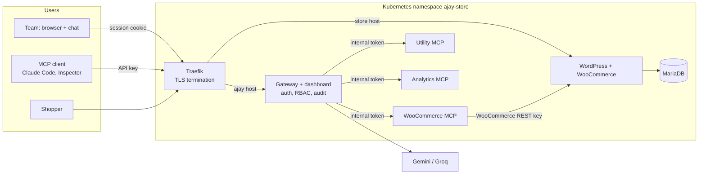

# Project AJAY: Team MCP Gateway on Kubernetes

A WooCommerce store on Kubernetes with an MCP gateway in front of it. Team members connect any MCP client to **one endpoint** with **their own API key**, and get the tools of several MCP servers, including a WooCommerce MCP server written for this project. Admins manage servers, people, keys and an audit log from a dashboard that also has an AI chat agent.


| | |
|---|---|
| Dashboard | https://ajay.ajayankam.tech |
| MCP endpoint | https://ajay.ajayankam.tech/mcp (requires a gateway API key; returns 401 without one) |
| Storefront | https://store.ajayankam.tech |
| Demo video | _link to be added_ |

Running on a single-node k3s cluster (Hostinger VPS), installed with the Helm chart in this repository.

## Why a gateway

Without a gateway, every person who wants an AI assistant to work with the store needs the store's REST credentials in their own client config. Nobody can see who did what, and removing one person means rotating a shared secret.

With the gateway:

- **One URL, personal keys.** Each person gets their own revocable key. Store and MCP server credentials stay inside the cluster.
- **Roles decide which tools you see.** Members never see write tools such as `create_product`, and the gateway rejects them if called anyway.
- **Every call is audited:** user, server, tool, duration and outcome.
- **Upstream failures stay contained.** A dead or slow MCP server only removes its own tools.

## Capabilities

- `POST /mcp`: Streamable HTTP MCP endpoint that aggregates tools from every enabled server as `<server>__<tool>`.
- Three in-cluster MCP servers with 16 tools: **WooCommerce** (written for this project, 6 tools), **Utility** (5) and **Sales Analytics** (5).
- Admin and member roles, one-time invite links, per-user API keys (shown once, stored as SHA-256 hashes).
- Server status in the dashboard: Connected, Unreachable or Disabled, with the tools each server exposes.
- AI chat (Gemini, then Groq as fallback) that calls tools as the logged-in user and asks for approval before any write.
- One Helm chart for the whole platform: persistent volumes, Traefik Ingress, probes and limits, Secrets, default-deny NetworkPolicies.

## Architecture



Only Traefik is public. The MCP servers and MariaDB have no Ingress, and NetworkPolicies allow only the paths drawn above.

## How a tool call works

1. The client sends `tools/list` or `tools/call` to `/mcp` with `Authorization: Bearer ajay_…`.
2. The gateway hashes the key and looks it up. Unknown or revoked keys get 401 on that request.
3. For `tools/list`, it asks every enabled server in parallel (10 s timeout each) and returns the tools this user's role allows.
4. For `tools/call`, it splits `woocommerce__list_orders` into server and tool, checks the server is enabled and the role is allowed, then calls the server with the **gateway's own** token. The client's key never leaves the gateway.
5. The result goes back to the client, and an audit row records the call.

MCP, the REST tool API and chat all go through the same dispatch code (`GatewayTools`), so policy and audit cannot be skipped by choosing a different path. The full sequence is in [system design](docs/system-design.md#2-a-tool-call-end-to-end).

## Technology

| Layer | Technology |
|---|---|
| Gateway | Node.js 24, TypeScript, Express 5, MCP TypeScript SDK, SQLite (`node:sqlite`) |
| Dashboard | React 19, Vite, Tailwind CSS 4, TanStack Query (served by the gateway) |
| MCP servers | TypeScript, MCP SDK, Streamable HTTP |
| Store | WordPress 7 + WooCommerce, MariaDB 11.4 |
| Chat | Google Gemini API, Groq (OpenAI-compatible) |
| Platform | Helm, k3s (production), Kind (local), Traefik, cert-manager + Let's Encrypt |
| CI | GitHub Actions: tests, then images to GHCR tagged with the commit SHA |

## Engineering decisions

| Decision | Why | Trade-off |
|---|---|---|
| Stateless `/mcp`: every request re-authenticates | Revocation applies to the very next request; works behind any load balancer | No `listChanged` notifications, so clients re-list tools after a server is disabled |
| Gateway holds upstream credentials; client keys are never forwarded | Members use tools without seeing secrets, and a compromised upstream learns nothing reusable | The gateway is the high-value target |
| WooCommerce MCP uses the WooCommerce REST API | Versioned, validated, runs WooCommerce's own hooks; no shell or SQL access to the store | Needs a REST key and HTTPS (in-cluster, via `X-Forwarded-Proto`) |
| SQLite on a volume for gateway state | No extra database to run or secure; backup is one file | One gateway replica (`Recreate` strategy) |
| Images pinned by digest, built only by CI from `main` | Every running pod maps to a known commit; rollback runs exactly the old code | A deploy needs the CI image file for that commit |

More decisions and their reasoning: [docs/system-design.md](docs/system-design.md#5-design-decisions).

## Local development (Kind)

Requires Docker, `kind`, `kubectl`, `helm` and Node.js 24.

```bash
kind create cluster --name ajay
docker build -f apps/gateway/Dockerfile -t ajay-gateway:dev .
docker build -f apps/mcp-woocommerce/Dockerfile -t ajay-mcp-woocommerce:0.2.0 .
docker build -f apps/mcp-business/Dockerfile -t ajay-mcp-business:dev .
kind load docker-image ajay-gateway:dev ajay-mcp-woocommerce:0.2.0 ajay-mcp-business:dev --name ajay
```

1. Create the namespace `ajay-store` and the Secrets listed in [system design](docs/system-design.md#secrets) (names only; values never go in the repo).
2. Install Traefik: `helm install traefik oci://ghcr.io/traefik/helm/traefik --version 42.1.3 -n traefik --create-namespace --skip-crds -f deploy/traefik/values-kind.yaml`
3. Install the platform: `helm upgrade --install ajay deploy/helm/urumi-platform -n ajay-store -f deploy/helm/urumi-platform/values-local.yaml`
4. `kubectl port-forward -n traefik svc/traefik 8080:80`, then open http://ajay.localtest.me:8080 (dashboard) and http://store.localtest.me:8080 (store). `*.localtest.me` resolves to 127.0.0.1.
5. Finish the WordPress install, activate WooCommerce, create a REST key and store it in the `ajay-woocommerce-api` Secret.

Tests:

```bash
npm ci
npm run test --workspace=@project-ajay/gateway     # 80 tests
npm run test --workspace=@project-ajay/dashboard   # 5
npm run test --workspace=mcp-woocommerce           # 5
npm run test --workspace=mcp-business              # 12
```

## Production deployment

The same chart runs on k3s with [`values-prod.yaml`](deploy/helm/urumi-platform/values-prod.yaml). The full procedure is in **[docs/vps-deployment.md](docs/vps-deployment.md)**. In short:

1. A merge to `main` runs [the image workflow](.github/workflows/images.yml): tests, then three `linux/amd64` images pushed to GHCR as `sha-<commit>`, plus a values file with their digests.
2. The chart refuses to render production without those image references, so nothing untracked gets deployed.
3. The first install happens in three phases: private bootstrap with no Ingress (WordPress installed with WP-CLI, the REST key generated straight into a Secret), then staging certificates, then production certificates and the HTTP→HTTPS redirect.
4. Credentials are created on the VPS and go straight into Kubernetes Secrets, which k3s encrypts at rest.

## Security

Covered in the [threat model](docs/threat-model.md). Highlights:

- Passwords use scrypt. API keys, sessions and invites are random tokens stored only as hashes.
- Member restrictions are enforced on the server, not only hidden in the UI. Denied calls are audited.
- Default-deny NetworkPolicies: only Traefik reaches the gateway and store, only the gateway reaches the MCP servers, only WordPress reaches MariaDB. A negative test confirmed this on the production cluster.
- Gateway and MCP pods run as non-root, with a read-only filesystem and no Kubernetes API token.

## Known limitations

- Single gateway replica, because of SQLite and the in-memory login throttle.
- No per-user rate limit on chat, which shares the free LLM quota.
- Credentials for servers that admins add through the dashboard are stored unencrypted in SQLite. The bundled servers' tokens come from Secrets.
- Admin actions such as adding servers or changing roles are not audited; tool calls are.
- No OAuth: MCP clients authenticate with gateway API keys only.

## Documentation

| Document | Contents |
|---|---|
| [System design](docs/system-design.md) | Components, request flow, Kubernetes layout, design decisions |
| [Threat model](docs/threat-model.md) | Trust boundaries, credentials, controls, remaining risks |
| [VPS deployment](docs/vps-deployment.md) | k3s runbook: images, Secrets, bootstrap, TLS, backups, rollback |
| [Demo guide](docs/demo-runbook.md) | 5–7 minute walkthrough with talking points |
