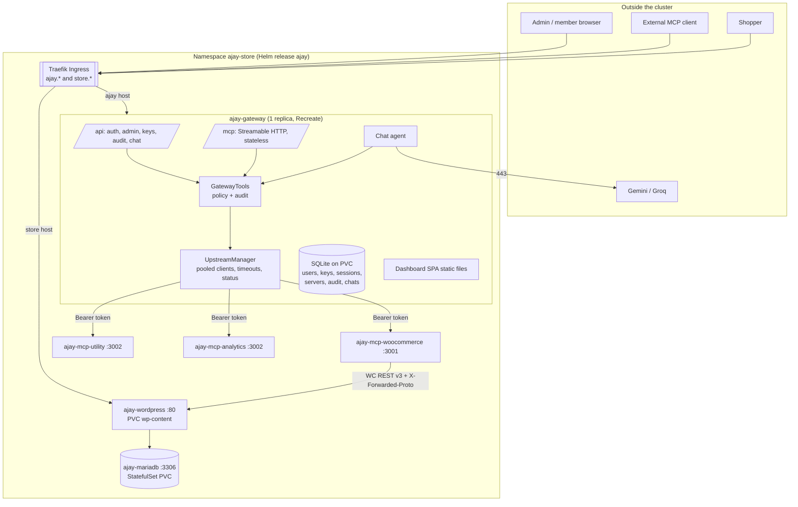
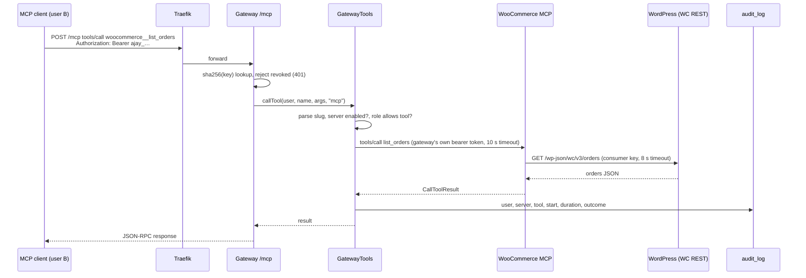

# System design and trade-offs

This document covers how Project AJAY is built and why, plus what changes between local Kind and a k3s VPS.

- Setup steps: [README](../README.md)
- Security analysis: [threat-model.md](threat-model.md)

## 1. Architecture

## 2. Components

| Component | Responsibility | Source |
|---|---|---|
| Gateway HTTP app | Express 5 app; mounts health, `/mcp`, `/api/mcp` (REST), auth, account, admin, chat and the dashboard | [app.ts](../apps/gateway/src/app.ts) |
| MCP endpoint | Stateless Streamable HTTP. Each POST authenticates its API key and is served by a fresh low-level SDK `Server` bound to that user. GET/DELETE return 405 | [mcp-endpoint.ts](../apps/gateway/src/routes/mcp-endpoint.ts) |
| `GatewayTools` | **The single dispatch path** for MCP, REST and chat: namespacing, role and server checks, routing, audit | [gateway-tools.ts](../apps/gateway/src/mcp/gateway-tools.ts) |
| `UpstreamManager` | One pooled MCP client per enabled upstream, request timeout, status (`connected` / `unreachable` / `disabled` / `pending`) refreshed every `STATUS_REFRESH_MS` | [upstream-manager.ts](../apps/gateway/src/mcp/upstream-manager.ts) |
| Bundled servers | On every start, registers or updates the three in-cluster servers from Helm values. URL and credential follow Helm; name, enabled state and admin-only tools stay under admin control | [bundled-servers.ts](../apps/gateway/src/mcp/bundled-servers.ts) |
| Chat agent | LLM tool loop over the user's visible tools; approval for writes; provider fallback chain | [chat/agent.ts](../apps/gateway/src/chat/agent.ts), [providers/](../apps/gateway/src/chat/providers) |
| Dashboard | React SPA built into the gateway image and served on the same origin (`DASHBOARD_DIR`) | [apps/dashboard](../apps/dashboard) |
| WooCommerce MCP | Self-written; 6 tools; stateful MCP sessions; bearer auth; WooCommerce REST API v3 | [apps/mcp-woocommerce](../apps/mcp-woocommerce) |
| Utility / Analytics MCP | One image, two Deployments; 5 tools each; stateless calculations on input data | [apps/mcp-business](../apps/mcp-business) |
| WordPress + WooCommerce | The storefront and order store (official `wordpress` image) | [wordpress-deployment.yaml](../deploy/helm/urumi-platform/templates/wordpress-deployment.yaml) |
| MariaDB | WordPress database (StatefulSet) | [mariadb-statefulset.yaml](../deploy/helm/urumi-platform/templates/mariadb-statefulset.yaml) |

## 3. MCP and tool-calling flow

### Aggregation and naming
- `tools/list` asks every **enabled** upstream in parallel (`Promise.allSettled`), each call bounded by `UPSTREAM_TIMEOUT_MS` (10 s).
- A failed or slow upstream is marked `unreachable` and omitted; the rest are returned.
- Tools are exposed as `<slug>__<tool>` ([tool-names.ts](../apps/gateway/src/mcp/tool-names.ts)):
  - Slugs are unique per server and contain no `__`, so the first `__` splits the name unambiguously.
  - `utility__get_server_info` and `analytics__get_server_info` demonstrate the collision case.
  - Descriptions are prefixed with `[Server name]`.
- Admin-only tools are filtered out of a member's list.

### A call, end to end

**Failures become MCP tool errors (`isError: true`) with a clear message**, rather than transport failures:
- "Upstream "x" timed out after 10000ms"
- server disabled
- "requires the admin role"

They are audited as `error` or `denied`.

**Retries:**
- **Listing** is idempotent, so it is retried once on a stale pooled connection.
- **Calls** are retried only when the upstream provably rejected the stale session before executing anything, so a write never runs twice.

### Chat agent loop
1. The agent loads the tools the logged-in user can see, through the same `GatewayTools.listTools(user)`.
2. It sends the history, the tools and a system prompt to the first working provider in the chain.
3. Each tool call runs as that user through `GatewayTools.callTool(user, …, "chat")`, so it is audited under the user.
4. Write tools stop the loop. A pending action is stored, and the dashboard shows an approval card. Approval is taken atomically from the DB (`takePendingAction`) and executes once; rejection or expiry (10 min) records the call as not run.
5. The loop runs up to `CHAT_MAX_TOOL_ROUNDS` (8). Identical calls in one turn are deduplicated.

The providers are Gemini (native API, keeping thought signatures across rounds) and then Groq (OpenAI format).
- Any provider error, rate limit or timeout moves to the next provider and model.
- Once a turn falls back, it stays on that provider.
- If every provider fails, the API returns `503 LLM_UNAVAILABLE`, keeping the user message and any tool results already obtained.

## 4. Authentication and authorization

| Caller | Credential | Check |
|---|---|---|
| Dashboard and chat | Session cookie `ajay_session` (random token, SHA-256 hash in `sessions`, TTL 12 h) | [session-auth.ts](../apps/gateway/src/middleware/session-auth.ts); mutations require a JSON content type |
| MCP endpoint and REST tool API | `Authorization: Bearer ajay_…` (SHA-256 hash in `api_keys`) | [api-key-auth.ts](../apps/gateway/src/middleware/api-key-auth.ts); revoked → 401 `API_KEY_REVOKED` |
| Gateway → upstream | Per-server static bearer or header credential, stored server-side | Never returned by the API; client keys are never forwarded |
| WooCommerce MCP → store | WooCommerce consumer key and secret (Basic) | Kubernetes Secret `ajay-woocommerce-api` |

Roles:
- `admin` manages servers, users and keys, and may call admin-only tools.
- `member` uses the tools it can see and manages its own keys.
- The last admin cannot be demoted or removed.

## 5. Data and persistence

| Data | Store | Volume |
|---|---|---|
| Products, orders, customers, WordPress settings | MariaDB | `mariadb-data-ajay-mariadb-0` (2 Gi) |
| Plugins, uploads, `wp-config.php` | WordPress | `ajay-wordpress-data` (2 Gi) |
| Users, API key hashes, sessions, servers (incl. upstream credentials), audit log, chat history | SQLite (`node:sqlite`, WAL) | `ajay-gateway-data` (1 Gi) mounted at `/data` |

The WooCommerce MCP and business servers are stateless. The gateway, WordPress and WooCommerce MCP use the `Recreate` strategy, so two pods never share one RWO volume or session map.

## 6. Kubernetes layout
- One chart ([deploy/helm/urumi-platform](../deploy/helm/urumi-platform)) installs every workload of the platform. Traefik (Kind) or the k3s-bundled Traefik is installed separately as cluster infrastructure.
- **Ingress:** two hosts, gateway (`ajay.*`) and store (`store.*`) ([ingress.yaml](../deploy/helm/urumi-platform/templates/ingress.yaml)). `/mcp`, `/api` and the SPA share the gateway host.
- **Probes:** every chart workload has readiness and liveness probes, plus startup probes for MariaDB, WordPress and the gateway (`/health`, `/ready`).
- **Requests and limits:** set on every chart workload. Totals are 450m CPU and 960 Mi requested, 2.75 CPU and about 2.9 Gi limit ([values.yaml](../deploy/helm/urumi-platform/values.yaml)).
- **Secrets:**
  - Operator-created: `ajay-mariadb-auth`, `ajay-mcp-auth`, `ajay-woocommerce-api`, `ajay-gateway`.
  - Chart-generated and kept across upgrades: `<release>-mcp-business-auth`.
  - The chart never contains secret values.
- **Pod hardening (gateway and MCP pods):** `runAsNonRoot`, read-only root filesystem, all capabilities dropped, `automountServiceAccountToken: false`. WordPress and MariaDB use the official images, which run as root.

### NetworkPolicy boundaries
[networkpolicy.yaml](../deploy/helm/urumi-platform/templates/networkpolicy.yaml) defines six policies:
- Default deny (ingress and egress) for every pod of the release, with DNS allowed.
- Then explicit allows:

| Pod | Ingress allowed from | Egress allowed to |
|---|---|---|
| gateway | Traefik → 3000 | WooCommerce MCP 3001, utility/analytics 3002, public internet 443 (LLM APIs; private ranges excluded) |
| wordpress | Traefik, WooCommerce MCP (and configured extra clients) → 80 | MariaDB 3306, public internet 443 |
| mariadb | WordPress → 3306 | — |
| mcp-woocommerce | gateway → 3001 | WordPress 80 |
| mcp-utility / mcp-analytics | gateway → 3002 | — |

Ports are container ports, because policies are evaluated after Service DNAT.

Enforcement was verified on Kind (kindnetd):
- the allowed paths work
- unrelated pods are blocked from MariaDB, WordPress and the MCP servers
- the gateway is blocked from MariaDB and from port 80 on the internet

k3s enforces NetworkPolicies with its embedded controller, but this has **not yet been verified on the VPS**.

## 7. Local vs VPS
The same chart is used; only the values file changes.

| Concern | `values-local.yaml` (Kind) | `values-prod.yaml` (k3s) |
|---|---|---|
| Storage class | `standard` | `local-path` |
| Images | local build + `kind load`, `pullPolicy: Never` | `ghcr.io/ajay-ankam/*` |
| DNS / hosts | `*.localtest.me` (resolves to 127.0.0.1), port-forward `:8080` | real domain A records (placeholders in the file) |
| Ingress controller | Traefik in ns `traefik` | k3s Traefik in `kube-system`, `websecure` entrypoint, HTTP→HTTPS redirect ([deploy/k3s](../deploy/k3s)) |
| TLS | none | cert-manager `letsencrypt-prod`, Secrets `<release>-gateway-tls` / `-store-tls` |
| Cookies | `cookieSecure: false` | `cookieSecure: true` |
| WordPress URL | `http://store.localtest.me:8080` | `https://store.<domain>` (via `WORDPRESS_CONFIG_EXTRA`, no DB rewrite) |
| Secrets | `kubectl create secret` (same names) | same names, created on the VPS |

Upgrades and rollbacks use `helm upgrade` and `helm rollback` ([README](../README.md#local-setup-kind)). The VPS deployment is **planned, not yet performed**.

## 8. Failure isolation

| Failure | Behaviour |
|---|---|
| Upstream pod killed or scaled to 0 | Its listing fails within the timeout and it is marked Unreachable. The dashboard shows it within one refresh (5 s in the chart). Other tools keep working, and the status recovers automatically |
| Upstream slow | Each call is bounded at 10 s and returned as a tool error. Listing waits at most 10 s for that server |
| Server disabled by admin | Tools disappear from the next listing (chat and clients); direct calls are `denied` |
| Store slow | The WooCommerce MCP times out at 8 s (below the gateway's 10 s), so the error message names WooCommerce |
| LLM provider down or out of quota | Falls through the chain; a final 503 keeps the conversation |
| Gateway restart | Stateless MCP endpoint: clients simply send the next request. Sessions survive in SQLite |

Tested in [mcp-endpoint.test.ts](../apps/gateway/src/routes/mcp-endpoint.test.ts) with fake upstreams. Disable and enable has been verified live; the pod-kill demo is part of the remaining live run.

## 9. Trade-offs

| Decision | Why | Cost |
|---|---|---|
| **Stateless `/mcp`** | Every request re-authenticates, so revocation is immediate, and it works behind any load balancer | No `listChanged` notifications; clients re-list after a server is disabled |
| **SQLite (`node:sqlite`)** | No extra database or dependency, and a simple backup | One gateway replica (RWO PVC, `Recreate`); the login throttle is in memory |
| **Dashboard served by the gateway** | Same origin, so the cookie needs no CORS, and there is one image and pod fewer | UI and API deploy together |
| **Low-level SDK `Server`** | A proxy must forward tool schemas unknown at compile time | Slightly more code than `McpServer` |
| **WooCommerce REST API** (not WP-CLI or SQL) | Versioned, validated and runs WooCommerce hooks; needs no shell in the WordPress pod | Needs a consumer key, and HTTPS (satisfied in-cluster by `X-Forwarded-Proto`) |
| **Gateway-held upstream credentials** | Members use tools without ever seeing upstream secrets; one place to rotate | The gateway is a high-value target (see the threat model) |
| **Chat approval for writes** | A human confirms side effects requested by an LLM | One extra click |
| **Native Gemini API + Groq fallback** | Free tiers; the native API preserves thought signatures for multi-round tool use | Two provider adapters to maintain |

## 10. Production changes beyond values (not yet done)
- Push the GHCR images.
- Use a WP-CLI bootstrap (or a manual runbook) for a fresh store.
- Back up MariaDB (`mariadb-dump`) and SQLite (`VACUUM INTO`) off the box.
- Add an uptime check.
- For more than one gateway replica: move to Postgres and a shared rate limiter.
