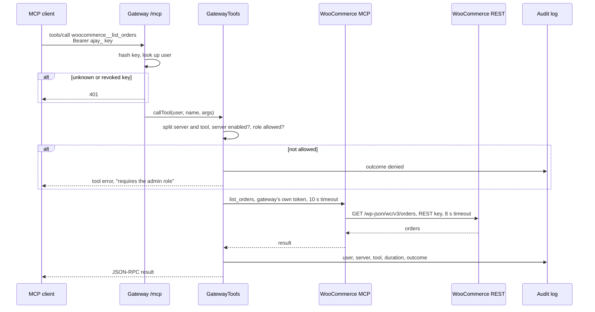
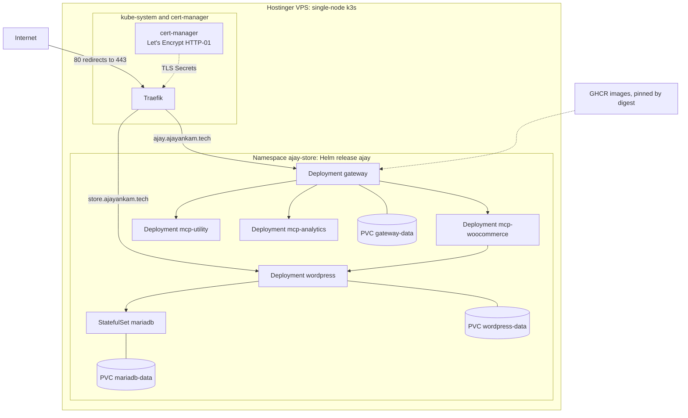

# System design

How Project AJAY is built, and why. For setup see the [README](../README.md); for security see the [threat model](threat-model.md).

## 1. Components

| Component | Responsibility | Source |
|---|---|---|
| Gateway | Express app. Serves `/mcp`, the REST API (`/api/*`), invite links and the dashboard files. Owns users, keys, server registry, audit log and chat | [apps/gateway](../apps/gateway) |
| `GatewayTools` | The single dispatch path for MCP, REST and chat: tool naming, role and server checks, routing, audit | [gateway-tools.ts](../apps/gateway/src/mcp/gateway-tools.ts) |
| `UpstreamManager` | One pooled MCP client per enabled server, per-call timeout, status refresh | [upstream-manager.ts](../apps/gateway/src/mcp/upstream-manager.ts) |
| Dashboard | React app built into the gateway image and served from the same origin: Overview, Servers, Team, API Keys, Audit, Chat | [apps/dashboard](../apps/dashboard) |
| WooCommerce MCP | Written for this project. 6 tools over the WooCommerce REST API v3 | [apps/mcp-woocommerce](../apps/mcp-woocommerce) |
| Utility / Analytics MCP | One image, two Deployments, 5 tools each. Pure calculations on the input they get; no store access | [apps/mcp-business](../apps/mcp-business) |
| WordPress + WooCommerce | Storefront, products and orders (official `wordpress` image) | [wordpress-deployment.yaml](../deploy/helm/urumi-platform/templates/wordpress-deployment.yaml) |
| MariaDB | WordPress database, as a StatefulSet | [mariadb-statefulset.yaml](../deploy/helm/urumi-platform/templates/mariadb-statefulset.yaml) |

**Tools**

| Server | Tools |
|---|---|
| `woocommerce` | `list_products`, `get_product`, `list_orders`, `get_order`, `create_product`*, `update_order_status`* |
| `utility` | `calculate_discount`, `calculate_order_total`, `calculate_profit_margin`, `convert_currency`, `get_server_info` |
| `analytics` | `summarize_sales`, `get_sales_trend`, `get_top_products`, `get_order_status_breakdown`, `get_server_info` |

\* Admin-only. A member sees 14 tools, an admin 16. Analytics takes the orders returned by `woocommerce__list_orders` as input, so one question can use two servers.

## 2. A tool call, end to end

**Discovery.** `tools/list` asks every enabled server in parallel, each bounded by the 10 s timeout. A server that fails is marked Unreachable and left out; the others are still returned.

**Naming.** Tools are exposed as `<slug>__<tool>`. Slugs are unique and cannot contain `__`, so the name always splits unambiguously. Both business servers have `get_server_info`, which shows the collision case working.

**Errors.** Timeouts, disabled servers and role denials come back as MCP tool errors (`isError: true`) with a readable message, not as transport failures.

**Retries.** A listing is retried once on a stale pooled connection. A call is retried only if the upstream rejected the stale session before running anything, so a write never runs twice.

### Chat agent

The chat agent ([agent.ts](../apps/gateway/src/chat/agent.ts)) uses the same path:

1. It loads the tools the logged-in user can see, through `GatewayTools`.
2. It sends the conversation and tools to the first working provider: Gemini models, then Groq models. Errors, rate limits and timeouts (60 s) move to the next one.
3. Each tool call runs as the user and is audited with source `chat`.
4. Write tools pause the loop and show an approval card. Approval executes the stored arguments exactly once; it expires after 10 minutes.
5. At most 8 tool rounds per message.

## 3. Authentication, roles and audit

| Caller | Credential | Stored as |
|---|---|---|
| Dashboard, chat | Session cookie (HttpOnly, SameSite=Strict, Secure in production), 12 h | SHA-256 hash |
| MCP and REST tool API | `Authorization: Bearer ajay_…`, 32 random bytes | SHA-256 hash and display prefix |
| Login | Email and password; 10 failures per IP per 15 min, then 429 | scrypt |
| Invite link | One-time token, 72 h | SHA-256 hash |

- **admin**: manages servers, users and keys, sees the whole audit log, may call admin-only tools.
- **member**: calls the tools it can see, manages its own keys, sees its own audit rows. The last admin cannot be demoted.
- Admin-only tools are **hidden** from members in `tools/list` and **rejected** if called directly.
- Every tool call on every path is written to `audit_log`: user, source (`mcp`, `rest`, `chat`), server, tool, start time, duration, outcome (`success`, `error`, `denied`) and error text.

## 4. Kubernetes deployment

- **Helm.** One chart, [deploy/helm/urumi-platform](../deploy/helm/urumi-platform), installs every workload: 5 Deployments, the MariaDB StatefulSet, ClusterIP Services, 2 Ingresses, 3 PVCs and 6 NetworkPolicies. The ingress controller and cert-manager are cluster infrastructure installed separately.
- **Ingress.** Two hosts. The gateway host serves the dashboard, `/api` and `/mcp` on one origin, so the session cookie needs no CORS. The store host serves WordPress. Ingresses use Traefik's HTTPS entrypoint only, so logins and keys never travel over port 80.
- **Probes and limits.** Every workload has readiness and liveness probes (startup probes too for gateway, WordPress and MariaDB) and CPU and memory requests and limits.
- **Persistence.** The gateway and WordPress volumes are marked `helm.sh/resource-policy: keep`; the MariaDB volume comes from the StatefulSet and is never deleted by Helm. The gateway, WordPress and WooCommerce MCP use the `Recreate` strategy, so two pods never share a ReadWriteOnce volume.
- **Pod hardening.** Gateway and MCP pods run as uid 1000, with a read-only root filesystem, all capabilities dropped and no service-account token. WordPress and MariaDB use the official images, which run as root.

### Secrets

The chart only references Secrets by name. Values are created on the cluster and never committed.

| Secret | Keys | Read by |
|---|---|---|
| `ajay-mariadb-auth` | `root-password`, `user-password` | MariaDB, WordPress |
| `ajay-mcp-auth` | `token` | WooCommerce MCP (inbound) and gateway (outbound) |
| `ajay-woocommerce-api` | `consumer-key`, `consumer-secret` | WooCommerce MCP |
| `ajay-gateway` | `GEMINI_API_KEY`, `GROQ_API_KEY`, `BOOTSTRAP_ADMIN_PASSWORD` (all optional) | Gateway |
| `ajay-mcp-business-auth` | `utility-token`, `analytics-token` | Generated by the chart on first install, kept on upgrade |

### Network policies

Default deny for ingress and egress on every pod of the release, DNS allowed, then:

| Pod | Accepts traffic from | May connect to |
|---|---|---|
| gateway | Traefik | the three MCP servers; public internet on 443 (LLM APIs) |
| wordpress | Traefik, WooCommerce MCP | MariaDB; public internet on 443 (plugin updates) |
| mariadb | WordPress | nothing |
| mcp-woocommerce | gateway | WordPress |
| mcp-utility, mcp-analytics | gateway | nothing |

"Public internet" excludes private and link-local ranges, so a URL an admin registers cannot reach other internal services.

### Local Kind vs production k3s

The chart is the same; only the values file changes.

| | Local ([values-local.yaml](../deploy/helm/urumi-platform/values-local.yaml)) | Production ([values-prod.yaml](../deploy/helm/urumi-platform/values-prod.yaml)) |
|---|---|---|
| Images | Built locally, `kind load` | GHCR `sha-<commit>`, pinned by digest |
| Hosts | `ajay.localtest.me`, `store.localtest.me` via port-forward 8080 | `ajay.ajayankam.tech`, `store.ajayankam.tech` |
| TLS | none | cert-manager, Let's Encrypt; HTTP redirects to HTTPS |
| Ingress controller | Traefik installed in namespace `traefik` | Traefik bundled with k3s |
| Storage class | `standard` | `local-path` |
| Session cookie | not Secure | Secure |
| Secrets at rest | Kind defaults | k3s `--secrets-encryption` |

## 5. Design decisions

| Decision | Why | Trade-off |
|---|---|---|
| **Stateless `/mcp`.** A fresh MCP server object per request, bound to the authenticated user | Every request re-checks the key, so revocation is immediate; no session affinity needed | No `listChanged` push; clients re-list after a server is disabled |
| **One dispatch path** (`GatewayTools`) for MCP, REST and chat | Policy and audit live in one place and cannot be bypassed by switching interface | Every new interface must use it |
| **Gateway-held upstream credentials**; client keys never forwarded | Members get tools without secrets; one place to rotate; upstreams can't replay client keys elsewhere | The gateway becomes the high-value target |
| **Admin-only tools by role**, hidden and rejected | Writes need trust; members can't trigger them even through a prompt-injected model | Per-role, not per-user, granularity |
| **WooCommerce REST API** for the store server, rather than WP-CLI or SQL | Supported, versioned interface that validates data and runs WooCommerce hooks | Needs a REST key, and HTTPS for Basic auth; inside the cluster the server sends `X-Forwarded-Proto: https` |
| **SQLite** (`node:sqlite`) for gateway state | No extra database to run or secure; backup is one file (`VACUUM INTO`) | One replica; the login throttle is in memory |
| **Dashboard served by the gateway** | Same origin, so cookie auth needs no CORS; one image | UI and API deploy together |
| **Low-level MCP SDK `Server`** in the gateway | A proxy forwards tool schemas it does not know at build time | A little more code than the high-level helper |
| **Chat approval for writes** | A person confirms anything with side effects that a model asked for | One extra click |
| **Gemini first, Groq as fallback** | Free tiers; when one provider is rate-limited or down, chat keeps working | Two provider adapters to maintain |
| **Images built by CI and pinned by digest** | Each pod maps to a commit on `main`; `helm rollback` restores exactly the old code | Deploys need the image file CI publishes |
| **Three-phase first install** (private bootstrap, staging TLS, production TLS) | The WordPress installer is never public; Let's Encrypt rate limits are never at risk | A longer first install |

## 6. Failure behaviour

| Failure | What happens |
|---|---|
| MCP server pod killed or scaled to 0 | Listing it fails within the timeout. It shows Unreachable within one status refresh (5 s); other tools keep working; it recovers on its own |
| MCP server slow | Calls are cut at 10 s and returned as a tool error |
| Server disabled by an admin | Its tools disappear from the next listing; direct calls are denied |
| Store slow | The WooCommerce MCP gives up at 8 s, before the gateway's 10 s, so the error names the store |
| LLM provider down or out of quota | The next provider or model is used; if all fail, the API returns 503 and keeps the conversation |
| Gateway restart | MCP clients just send their next request; dashboard sessions are in SQLite and survive |

These cases are covered by the gateway tests, which use fake upstreams ([mcp-endpoint.test.ts](../apps/gateway/src/routes/mcp-endpoint.test.ts)).

## 7. Scaling limits

- The gateway runs one replica. More would need Postgres instead of SQLite and a shared rate limiter.
- The WooCommerce MCP keeps MCP sessions in memory, so it also runs one replica unless sticky sessions are added.
- Utility and Analytics are stateless and could scale out as they are.
