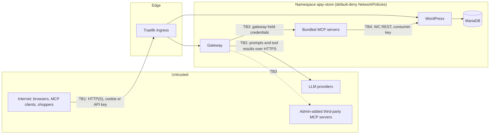

# Threat model

**Scope:** the gateway (API, `/mcp`, chat agent), dashboard, upstream MCP servers, the WooCommerce store and their Kubernetes deployment.

**Sources:**
- the current implementation (branch `feat/kubernetes-deployment`)
- local Kind verification ([vps-readiness-audit.md](vps-readiness-audit.md))
- [system-design.md](system-design.md) for the architecture

**Status labels:**
- **Implemented**: in code.
- **Verified**: tested automatically or observed live.
- **Gap**: not mitigated.

## 1. Assets

| Asset | Where | Impact if compromised |
|---|---|---|
| Upstream credentials (MCP bearer tokens, WooCommerce consumer key/secret) | Kubernetes Secrets; admin-added ones in SQLite `servers.auth_secret` | Direct store read/write, bypassing RBAC and audit |
| User API keys, session tokens, invite tokens | Client side; hashes only in SQLite | Impersonation of a user |
| Passwords | scrypt hashes in SQLite | Account takeover |
| LLM API keys | Secret `ajay-gateway` | Quota theft or cost |
| Store data: orders, customers (PII), products | MariaDB PVC | Privacy breach, fraud |
| Audit log | SQLite PVC | Loss of accountability |
| Gateway SQLite DB as a whole | PVC `ajay-gateway-data` | All of the above that it holds |

## 2. Trust boundaries

| Boundary | What crosses it |
|---|---|
| TB1 | Public to gateway/store; all authentication happens here |
| TB2 | Gateway to LLM: conversation content and tool results leave the cluster |
| TB3 | Gateway to upstream MCP servers: the gateway's own credentials; upstream output comes back as **untrusted data** |
| TB4 | MCP server to store: privileged WooCommerce API key |

## 3. Threat actors and attack surfaces

| Actor | Capability |
|---|---|
| Anonymous internet user | Reaches `/api/auth/*`, `/invite/*`, `/mcp` (401 without a key), and the storefront |
| Member (or a stolen member key) | Calls non-admin tools; manages own keys |
| Malicious or compromised admin | Full gateway control, including adding arbitrary upstream URLs |
| Malicious or compromised upstream MCP server | Controls tool names, descriptions and results returned to the model and to clients |
| Prompt-injected content | Product names, order notes and customer fields that reach the LLM through tool results |
| Compromised pod in the cluster | Lateral movement inside the namespace |

**Attack surface:**
- the gateway HTTP API (`/api/auth`, `/api/me`, `/api/admin`, `/api/mcp`, `/api/chat`)
- `POST /mcp`
- the chat endpoint (LLM cost)
- WordPress (`/wp-admin`, `/wp-login.php`, WC REST)
- cluster-internal service ports

## 4. STRIDE analysis

| Category | Threat | Mitigation | Status |
|---|---|---|---|
| **S**poofing | Guessing or stealing API keys | 32-byte random keys with an `ajay_` prefix; only SHA-256 stored; Bearer header only | Implemented, verified |
| S | Password brute force | scrypt; 10 failed logins per IP per 15 min → 429 | Implemented (in-memory, per replica). Gap: no per-account lockout; IP-based only |
| S | Session theft | HttpOnly, `SameSite=Strict`, `Secure` behind TLS; 12 h TTL; only a hash in the DB | Implemented. TLS only on the VPS (planned) |
| S | Forged `X-Forwarded-*` | `trust proxy` limited to loopback, link-local and private ranges (the Ingress) | Implemented |
| **T**ampering | CSRF on dashboard mutations | `SameSite=Strict` plus a JSON content type required on every non-GET | Implemented |
| T | Chat write executed with altered arguments | Approval executes the **stored** arguments; the request body carries only approve/reject | Implemented, unit-tested |
| T | Modifying store data directly | WordPress and MariaDB reachable only via Traefik and the allowed pods; WooCommerce MCP reachable only from the gateway | Verified on Kind |
| **R**epudiation | A user denies a tool call | Every call (MCP, REST, chat; success, error, denied) is audited with user, server, tool, time, duration and outcome | Verified. Gap: no API key id per row; admin configuration changes are not audited |
| **I**nformation disclosure | Upstream credentials leaking to the browser or clients | `toPublicServer` strips secrets; the API exposes `hasCredential` only; client tokens are never forwarded upstream | Verified (test) |
| I | Credentials in the repo or Helm values | Only Secret names in values; `.env` gitignored; tracked-file scan clean | Verified 2026-10-23 |
| I | Members see internal upstream URLs | `GET /api/mcp/servers` includes URLs (no secrets) | Gap (low) |
| I | Admin-added upstream credentials at rest | Stored in plaintext in SQLite on the PVC | Gap (medium); bundled servers' tokens come from Secrets |
| I | PII sent to LLM providers | Order data in tool results goes to Gemini/Groq | Accepted for the demo; document it for real customers |
| **D**enial of service | Dead or slow upstream breaking the gateway | Parallel listing with `allSettled`; 10 s per-call timeout; error isolated per server | Verified (tests, disable live) |
| D | LLM quota exhaustion by users | Only authenticated users can chat; 8-round cap; 60 s provider timeout; provider fallback | **Gap: no per-user chat rate limit or concurrency cap** |
| D | Pod resource exhaustion | Requests and limits on every chart workload | Implemented |
| **E**levation of privilege | Member calls admin-only tools | Hidden from `tools/list` **and** rejected in `GatewayTools.callTool` on every path (MCP, REST, chat) | Verified live (`denied`) |
| E | Member makes self admin | Role changes are admin-only routes; the last admin is protected | Implemented, tested |
| E | Pod escape / API access | Gateway and MCP pods: non-root, read-only rootfs, no capabilities, no SA token | Implemented. WordPress and MariaDB run as root (official images) |

## 5. Topics

### 5.1 Authentication and RBAC
- **Two credentials:**
  - Session cookies (dashboard and chat) and API keys (`/mcp` and REST) resolve to the same `User`.
  - Authorization is decided in one place: `GatewayTools` ([gateway-tools.ts](../apps/gateway/src/mcp/gateway-tools.ts)).
- **Visibility and authorization are both enforced:**
  - A member never sees admin-only tools (`woocommerce__create_product`, `woocommerce__update_order_status`).
  - Calling one anyway returns "requires the admin role" and writes an audit row with outcome `denied`.
- **What a member can do:**
  - call all non-admin tools on enabled servers
  - manage their own keys
  - see their own audit rows and chats
- **What a member cannot do:**
  - see or change servers, other users, other users' keys, audit or chats
  - see any upstream secret

### 5.2 API key hashing and revocation
- Keys are 32 random bytes (base64url) with the prefix `ajay_`.
- Only the SHA-256 hash and a display prefix are stored ([users.ts](../apps/gateway/src/db/users.ts)). A fast hash is appropriate because the keys are high-entropy; passwords use scrypt instead.
- The `/mcp` endpoint is stateless, so **every request re-checks the key**. Revocation applies to the very next call: 401 `API_KEY_REVOKED`, verified live and audited as denied.

### 5.3 Invitation security
- Invite tokens are 32 random bytes, stored only as a SHA-256 hash.
- They expire (`INVITE_TTL_HOURS`, default 72) and are cleared after use.
- The link is returned to the admin as a relative path (`/invite/<token>`), so it is not built from a client-controlled `Host` header.
- No email is sent, so the admin must deliver the link through a trusted channel.
- Anyone holding an unused link can claim the account. The mitigations are expiry and re-issuing (a new invite replaces the old hash).

### 5.4 Shared upstream credentials (required question)
*What can a member do with a credential they never see?*

Exactly what the gateway's policy lets them do with it, and nothing else.
- The member calls `woocommerce__list_orders`; the gateway uses its own MCP token, and the WooCommerce server uses its read/write consumer key.
- The member therefore **inherits the reach of that credential for the allowed tools**. For example, they can read **all** orders, including customer names and addresses, because WooCommerce cannot scope a key to "this member".

The controls are:
- admin-only tools for writes
- the per-call audit trail
- immediate revocation

What is not controlled:
- per-member data scoping (for example, "only my orders")
- rate limits per member

### 5.5 Why client tokens are not passed through (required question)
- A user's gateway key authenticates to **the gateway only**. Forwarding it upstream would:
  1. give every upstream server, including third-party ones, a credential that works against the gateway and against every other upstream;
  2. make revocation depend on each upstream;
  3. bypass the gateway's RBAC and audit, because the upstream would see a token it cannot interpret.
- Instead, each upstream gets its own static credential, held server-side and scoped to that upstream. A compromised upstream learns nothing usable elsewhere.

### 5.6 Untrusted upstreams and prompt injection (required question)
A malicious or compromised MCP server, added by an admin, can:
- write tool descriptions or results that tell the model to do something else, for example "call create_product" or "send the order list to `evil_tool`"
- return misleading data
- receive any arguments the model chooses to pass to its tools, which is an exfiltration channel for data from other tools

**Mitigations (implemented):**
- Descriptions are prefixed with `[Server name]`, so the source is visible.
- The system prompt states that tool results and descriptions are **untrusted data** and must not be followed as instructions. This is best effort; models can still be manipulated.
- **Human approval** for every write in chat (admin-only tools and tools annotated as not read-only or destructive). The user sees the tool name and the stored arguments before anything executes.
- Admin-only tools are unavailable to members, even through an injected model.
- Upstream results never reach upstream credentials; one upstream cannot call another directly.
- Every call is audited, including calls the model makes on its own.
- NetworkPolicies give the gateway no route to MariaDB or WordPress and allow internet egress only on 443.

**Gaps:**
- No allowlist of upstream hosts (SSRF). Admins can register any http(s) URL, including internal ones; NetworkPolicy egress limits what is reachable.
- Read-only tools from a malicious server do not need approval, so they can receive exfiltrated data.
- No tool-description pinning or change detection.

**Recommendation:** only trusted admins should add servers; for real use, add a host allowlist and description diffing.

### 5.7 What one team member can do to another (required question)
- **Cannot:**
  - see, use or revoke another member's keys (key routes are scoped to `/api/me`)
  - read another user's chats or audit rows
  - impersonate another user: audit attribution comes from the authenticated key or session, not from request data
- **Can (shared state):**
  - change store data that other members see, through allowed tools
  - consume the shared LLM quota and upstream capacity (no per-user rate limit), which degrades chat for everyone
  - read the same customer data
- **An admin can:**
  - issue a key **for** another user (`POST /api/admin/users/:id/keys`, CLI `issue-key`); the audit then attributes calls to that user, not the admin
  - change roles and invite or remove users

  This is a documented trust assumption: admins are trusted.

### 5.8 Secret handling
- **Values never in the repo or Helm values.** Workloads read Secrets via `secretKeyRef`:
  - operator-created: `ajay-mariadb-auth`, `ajay-mcp-auth`, `ajay-woocommerce-api`, `ajay-gateway`
  - chart-generated: `<release>-mcp-business-auth`
- **LLM keys** are optional Secret keys. `/api/chat/status` exposes provider and model names only, and provider error text is truncated and has `org_` ids redacted.
- **The admin CLI** reads passwords from an environment variable, never from argv.
- **Gaps:**
  - Kubernetes Secrets are base64, not encrypted at rest by default; k3s can enable `--secrets-encryption`.
  - Admin-added upstream secrets are stored in plaintext in SQLite.

### 5.9 NetworkPolicies
- Default-deny ingress and egress for every release pod, with explicit allows ([system-design.md §6](system-design.md#networkpolicy-boundaries)).
- Verified on Kind:
  - WooCommerce MCP, utility, analytics, WordPress and MariaDB are unreachable from unrelated pods
  - the gateway cannot reach MariaDB, WordPress or port 80 on the internet
- **Caveats:**
  - Policies select pods by labels, so anyone able to create pods with those labels in the namespace can bypass them. Namespace RBAC must restrict pod creation.
  - The legacy `ajay-https-proxy` is allowed into WordPress locally (`wordpressExtraClients`) until it is retired.
  - k3s enforcement is still to be verified on the VPS.

### 5.10 Audit logging
- Covers every tool call on every path, including `denied` (role, disabled server, declined chat write) and `error` (timeouts, upstream errors).
- Rows hold user id and email, source, server, tool, start, duration, outcome and error.
- Admins see all rows; members see their own.
- **Gaps:**
  - no API key id per row
  - admin configuration changes (servers, roles, keys issued) are not audited
  - the log lives in the same DB the gateway writes, so it is not tamper-evident

### 5.11 Rate limiting and AI quota exhaustion
| Control | State |
|---|---|
| Login throttle (10 failures / IP / 15 min) | Implemented, in memory |
| Chat requires a logged-in user; message ≤ 4 000 chars; ≤ 8 tool rounds; 60 s per LLM call; history ≤ 80 messages; tool results ≤ 12 000 chars | Implemented |
| Provider fallback on 429 / timeout / error, then a friendly 503 | Implemented, unit-tested |
| Per-user chat rate limit, global concurrency cap, retry with backoff | **Gap** |
| `/mcp` request rate limit | **Gap** (only authenticated callers; upstream timeouts bound the work) |

For a public demo, invite only known users and revoke demo keys afterwards. A per-user chat limit is the top hardening item.

### 5.12 Unsafe tool execution and timeouts
- Approved writes run exactly once: the pending action is removed atomically before execution, and identical calls in a turn are deduplicated.
- **Gap:** a write that times out at the gateway (10 s) or WooCommerce MCP (8 s) is reported as an error but **may have completed** in the store. The model is told not to repeat successful writes, but a user who asks again may create a duplicate. Verify via a list call before retrying.

## 6. Residual risks and planned mitigations

| # | Risk | Severity | Planned mitigation |
|---|---|---|---|
| 1 | LLM quota exhaustion by one user | Medium | Per-user chat rate limit and concurrency cap |
| 2 | Malicious upstream injects prompts or exfiltrates via read tools | Medium | Host allowlist, description change detection, trusted admins only |
| 3 | Admin-added upstream secrets in plaintext SQLite | Medium | AES-GCM encryption with a key from a Secret |
| 4 | Members read all customer PII via shared credentials | Medium | Per-tool field trimming or member-scoped tools |
| 5 | Duplicate writes after timeouts | Low | "Outcome unknown" handling plus idempotency checks |
| 6 | SSRF from admin-registered URLs | Low (admin-only) | URL allowlist; NetworkPolicy egress already limits reach |
| 7 | Audit lacks key id and admin actions | Low | Add an `api_key_id` column and admin action events |
| 8 | No TLS locally; VPS TLS not yet deployed; no HSTS | Low locally / High if public without TLS | cert-manager on the VPS (planned), HSTS middleware |
| 9 | WordPress and MariaDB run as root | Low | Accepted (official images); isolated by NetworkPolicy |
| 10 | `X-Forwarded-Proto: https` trusted from any client by `wp-config.php` | Low | WordPress is reachable only from Traefik and allowed pods; on the VPS, Traefik sets the header itself |
