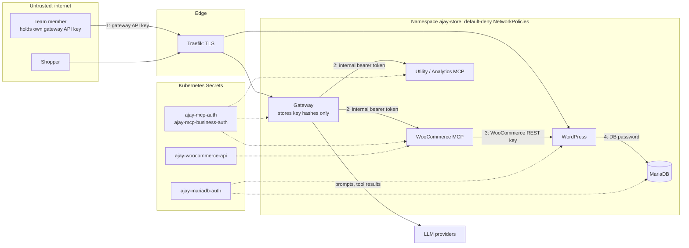

# Threat model

What the gateway protects, where the trust boundaries are, which controls exist today, and what is still open. Architecture details are in [system-design.md](system-design.md).

**Status labels:** **Verified**: tested automatically or observed on the running system. **Implemented**: in code, not separately tested. **Open**: not mitigated.

## 1. What we protect

| Asset | Where it lives |
|---|---|
| WooCommerce REST key (read/write store access) | Secret `ajay-woocommerce-api`, read only by the WooCommerce MCP pod |
| Gateway-to-MCP tokens | Secrets `ajay-mcp-auth`, `ajay-mcp-business-auth`; tokens for admin-added servers in SQLite |
| User API keys, sessions, invites, passwords | Only hashes, in the gateway's SQLite volume |
| LLM API keys | Secret `ajay-gateway` |
| Orders and customer data | MariaDB volume |
| Audit log | Gateway SQLite volume |

## 2. Credentials and trust boundaries

Each hop uses its own credential, and none is passed further along:

1. **Client → gateway.** A personal gateway API key. It is checked and stops at the gateway.
2. **Gateway → MCP servers.** A per-server token from a Secret. Clients never see it.
3. **WooCommerce MCP → store.** The WooCommerce REST key. Only this pod can read it, and only this pod (and Traefik) can reach WordPress.
4. **WordPress → MariaDB.** The database password. Only WordPress can reach MariaDB.

Tool results from MCP servers, and anything the LLM returns, are treated as **untrusted data**.

## 3. Controls

| Threat | Control | Status |
|---|---|---|
| Stolen or guessed API key | 32 random bytes, only the SHA-256 hash stored; key shown once; revocable per key | Verified: revoked key gets 401 `API_KEY_REVOKED` on the next request, in production |
| Password guessing | scrypt; 10 failed logins per IP per 15 min, then 429 | Implemented (in memory, per replica) |
| Session theft or CSRF | HttpOnly, SameSite=Strict, Secure cookie over HTTPS; mutating requests must be JSON | Implemented |
| Member calls a write tool | Admin-only tools hidden from `tools/list` and rejected in `GatewayTools` on MCP, REST and chat | Verified in production: "requires the admin role", audited as `denied` |
| Upstream credentials leak to clients | API returns only `hasCredential`; client keys never forwarded upstream | Verified (tests) |
| Prompt injection makes chat write something | Every write in chat needs explicit approval; approval runs the stored arguments once | Implemented, unit-tested |
| Direct access to MCP servers or database | ClusterIP only, no Ingress; default-deny NetworkPolicies | Verified in production: a pod outside the release was refused by WooCommerce MCP, Utility and MariaDB |
| Credentials in the repository | Chart holds Secret names only; values created on the cluster; `.env` ignored | Verified (repository scan) |
| Secrets readable from cluster storage | k3s Secrets encryption at rest | Implemented in production |
| Traffic interception | Let's Encrypt certificates on both hosts; HTTP redirected to HTTPS; Ingresses use the HTTPS entrypoint only | Verified in production |
| Pod compromise spreading | Gateway and MCP pods: non-root, read-only filesystem, no capabilities, no service-account token | Implemented |
| Untraceable actions | Every tool call audited with user, source, server, tool, duration, outcome, including denials | Verified in production |
| A dead MCP server takes down the gateway | Parallel listing, 10 s per-call timeout, failure isolated to that server | Verified (tests) |

## 4. Assignment questions

**What can a member do with a credential they never see?** Exactly what the gateway's policy allows with it. A member calling `woocommerce__list_orders` uses the store key indirectly, so they can read **all** orders, including customer details. WooCommerce cannot scope a key to one person. Writes are admin-only, every call is audited, and a member's access ends the moment their key is revoked. Per-member data scoping and per-member rate limits do not exist.

**Why not pass the client's token through to upstream servers?** The token would then work against the gateway and every other upstream, revocation would depend on each upstream, and upstreams would bypass the gateway's role checks and audit. Instead, each upstream gets its own token, scoped to that server.

**What can a malicious MCP server do?** An admin-registered server controls its tool descriptions and results, so it can try to steer the model or collect data passed to its tools. Mitigations:
- Descriptions are prefixed with the server name.
- The system prompt marks tool content as untrusted.
- Writes need approval, and members cannot reach admin-only tools.
- Every call is audited.
- Gateway egress is limited to the public internet on 443, so a registered URL cannot reach private ranges.

Open: there is no host allowlist and no detection of changed tool descriptions, and read-only tools on such a server need no approval.

**What can one member do to another?** They cannot see, use or revoke another member's keys, chats or audit rows; key routes are scoped to the caller. They can change shared store data through allowed tools and use up the shared LLM quota. Admins are trusted: an admin can issue a key for another user, and calls with that key are attributed to that user.

## 5. Open risks

| Risk | Severity | Recommended fix |
|---|---|---|
| Kubernetes API (6443) and kubelet (10250) reachable from the internet; both require authentication | High | Hostinger firewall: allow only 22, 80, 443 |
| One user can exhaust the shared LLM quota (no per-user chat limit) | Medium | Per-user rate limit and concurrency cap |
| Credentials for admin-added servers stored unencrypted in SQLite | Medium | Encrypt with a key from a Secret |
| Members can read all customer data through order tools | Medium | Field trimming or member-scoped tools |
| Malicious upstream: no URL allowlist or description change detection | Medium | Host allowlist, description diffing |
| A write that times out may still have completed in the store | Low | Check with a list call before retrying |
| Audit has no API key id, and admin configuration changes are not audited | Low | Add key id and admin events |
| WordPress and MariaDB run as root (official images) | Low | Accepted; isolated by NetworkPolicy |
| Single gateway replica, in-memory login throttle | Low | Postgres and a shared limiter if scaled |
